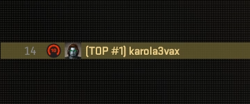

# Faceit Levels



Standalone MetaMod:Source plugin for Counter-Strike 2. It automatically shows every connected player's FACEIT level on the scoreboard to everyone. There is no player command and no CS:GO fallback.

## Features

- Enabled automatically after MetaMod loads it
- FACEIT levels 1 through 10 on the scoreboard
- Unknown or unranked players show no FACEIT icon
- One-hour cache and refresh for connected players
- Built-in Steam HTTP client; no CounterStrikeSharp or SwiftlyS2 dependency
- Runtime CS2 schema lookup instead of hard-coded inventory field offsets
- Windows and Linux support

## Requirements

- Counter-Strike 2 dedicated server
- MetaMod:Source 2.x
- A [FACEIT Data API key](https://developers.faceit.com/)
- The combined `server_assets` Workshop addon containing the FACEIT level images

## Installation

1. Extract the release into `game/csgo/`.
2. Open `game/csgo/addons/faceit_levels/config.ini` and set `api_key`.
3. Add the combined `server_assets` Workshop ID to MultiAddonManager.
4. Restart the server, or load `addons/metamod/faceit_levels.vdf` through MetaMod.

The package installs:

```text
addons/
|-- faceit_levels/
|   |-- bin/faceit_levels.dll
|   |-- bin/faceit_levels.so
|   `-- config.ini
`-- metamod/faceit_levels.vdf
```

The Windows and Linux binaries are distributed together in releases. Each platform build produces its own binary folder.

## Configuration

```ini
api_key=
refresh_minutes=60
request_timeout_seconds=10
max_concurrent_requests=4
game_entity_system_offset_windows=88
game_entity_system_offset_linux=80
```

Only `api_key` must normally be changed. The plugin stores its disposable API cache in `addons/faceit_levels/cache.tsv`.

## Building

Place the repositories side by side:

```text
faceit-levels/
hl2sdk-cs2/
metamod-source/
```

Then configure an optimized 64-bit CS2 build:

```bash
mkdir -p build && cd build
python ../configure.py --enable-optimize --targets=x86_64 -s cs2 \
  --mms_path ../../metamod-source \
  --hl2sdk-root ../.. \
  --hl2sdk-manifests ../../metamod-source/hl2sdk-manifests
ambuild
```

The packaged files are written below `build/package/cs2/`.

Linux release binaries are built on AlmaLinux 8 for compatibility with older Pterodactyl images such as the K4 egg.

## Credits

- [karola3vax on GitHub](https://github.com/karola3vax)
- [karola3vax on Steam](https://steamcommunity.com/profiles/76561198353131845/)
- [Pisex/cs2-faceit-level](https://github.com/Pisex/cs2-faceit-level) for the original scoreboard asset mapping and implementation idea
- [zhw1nq/swiftlyS2-faceit-scoreboard](https://github.com/zhw1nq/swiftlyS2-faceit-scoreboard) for the current CS2-only FACEIT lookup reference

FACEIT is a trademark of its respective owner. This project is not affiliated with or endorsed by FACEIT.

## License

Copyright (C) 2026 karola3vax.

Licensed under the GNU Affero General Public License v3.0 only. See [LICENSE](LICENSE).
